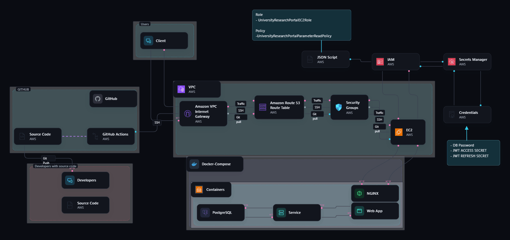
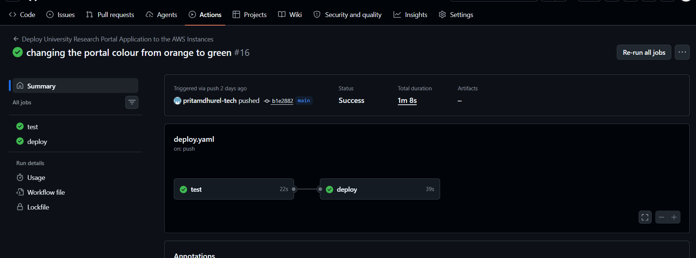
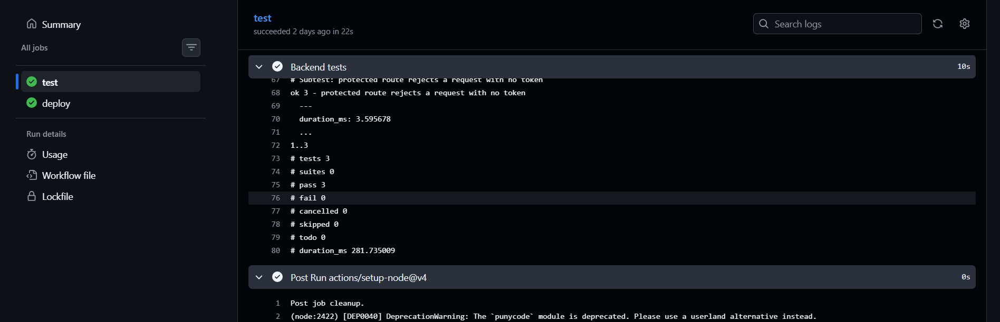
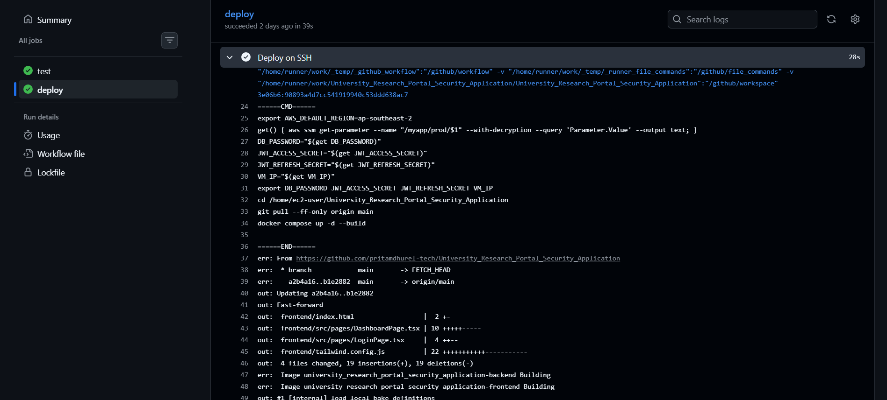
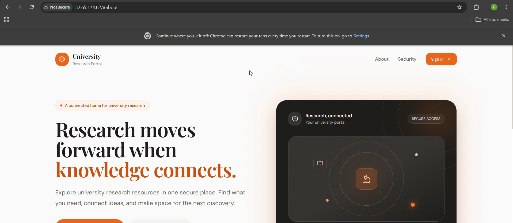
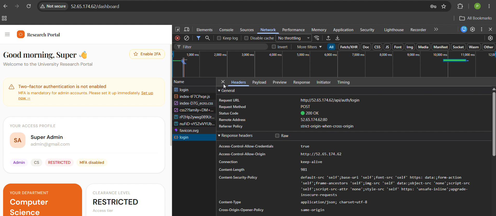
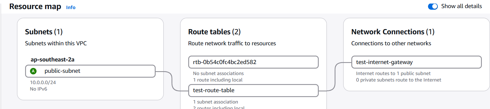

# From Code to the Cloud: My First CI/CD Project

[](https://github.com/pritamdhurel-tech/University_Research_Portal_Security_Application/actions/workflows/deploy.yaml)

Hi, I'm Dhurel, a Computer Science / IT student working towards a cloud engineering career. This repository is my first CI/CD project. It is also the first time I took an application I had built and made it run on a real cloud server, updating itself every time I push new code.

I want to be honest about how this went. It did not work the first time, or the second, or the tenth. Most of what I learned came from things breaking, so this README tells the whole story: what I built, how I built it, every problem I ran into and how I fixed it, and what I would still improve.

---

## What this project is

The application is the **University Research Portal**, a web app I originally built for a cybersecurity programming module. Students and staff sign in to browse research resources. It has JWT login with refresh tokens, two-factor authentication (TOTP), role and attribute based access control, and audit logging.

The app is built with:

- **Frontend:** React and Vite, served by nginx
- **Backend:** Express with Prisma
- **Database:** PostgreSQL 16

The CI/CD part is what this project is really about. When I push code to the `main` branch:

1. **GitHub Actions** starts a fresh machine and runs my backend tests.
2. If the tests pass, a second job **connects to my AWS server over SSH**.
3. On the server, it pulls the new code and rebuilds the Docker containers.
4. A minute or so later, the live website shows my change.

Before this project, deploying meant logging into the server by hand and typing commands. Now I push code and the pipeline does it.

---

## Video demo

▶ **[Watch the demo (about 90 seconds)](DEMO-LINK-HERE)**

In the video, you will see:

1. The live portal with the old orange theme.
2. Me changing the theme colour to green in my editor and pushing the commit to `main`.
3. The GitHub Actions page: the `test` job runs first, then the `deploy` job starts only after tests pass.
4. A refresh of the live site, now green.
5. Me signing in as the admin and opening the resources list, to show the backend, database and login still work after the automatic deploy.

The AWS instance is a short-lived test environment, so I keep it stopped when I am not using it. If you'd like to see it live, I can start it and run a deploy in front of you.

---

## How it works



_The diagram shows two flows. On the left, I push code to GitHub and GitHub Actions deploys it to the server over SSH. On the right, the server reads its secrets from AWS Systems Manager Parameter Store through an IAM role, and users reach the app through nginx on port 80._

```
git push to main
      │
      ▼
 test job (GitHub runner: install, generate Prisma client, run tests)
      │  only if the tests pass
      ▼
 deploy job ──SSH──► EC2 instance
                       │ 1. fetch secrets from Parameter Store (IAM role)
                       │ 2. git pull
                       └ 3. docker compose up -d --build
```

On the server, three containers run with Docker Compose:

- **frontend:** nginx serving the React build on port 80. It also forwards anything starting with `/api` to the backend, so the browser only ever talks to port 80.
- **backend:** the Express API on port 8003. When it starts, it runs the database migrations, loads the sample university data, then starts the server.
- **db:** PostgreSQL 16, with a health check so the backend waits until the database is ready.

---

## My journey, step by step

**1. Build the app.** I built the portal first as a normal PERN project running on my laptop, with a local `.env` file for secrets that never gets committed to git.

**2. Put it in Docker.** I wrote a multi-stage Dockerfile for the frontend (build with Node, serve with nginx), a Dockerfile for the backend, and a `docker-compose.yml` to run frontend, backend and database together.

**3. Practise on a VM.** Before touching AWS, I ran the Docker setup on an Ubuntu Server virtual machine on my own computer and copied files over with SCP. It was a safe place to make mistakes.

**4. Build the AWS environment.** I created a VPC, a public subnet, an internet gateway, a route table and a security group, launched an EC2 instance, and gave it an IAM role so it could read its secrets from Parameter Store. I did this by hand in the console so I understood every piece. I had just passed the AWS Solutions Architect Associate exam (SAA-C03), and this was my chance to use what I'd studied on something real.

**5. Deploy by hand first.** I installed Docker, pulled the code with git, and ran Docker Compose on the instance until the site worked. I wanted to know the manual steps before automating them, because automating something you don't understand just hides the problems.

**6. Write the pipeline.** I wrote the GitHub Actions workflow in `.github/workflows/deploy.yaml`. My first runs failed for a while (more on that below).

**7. Add tests and a gate.** I added backend tests and made the deploy job wait for them with `needs: test`. In an earlier run I noticed the test and deploy jobs were running side by side, which meant the tests weren't protecting anything. Adding that one line changed the run graph so deploy only starts after test succeeds.

**8. Make it feel real.** I changed the portal's colour from orange to green with a single commit and watched the live site change by itself, which was the moment the whole thing clicked for me.

---

## What I set up on AWS

| Piece            | What I configured                                                                    | Why                                                          |
| ---------------- | ------------------------------------------------------------------------------------ | ------------------------------------------------------------ |
| VPC              | `test-1`                                                                             | My own private network for the project                       |
| Subnet           | Public subnet, `10.0.0.0/24`                                                         | Where the web server lives                                   |
| Internet gateway | `test-internet-gateway`                                                              | Lets the subnet talk to the internet                         |
| Route table      | `0.0.0.0/0` goes to the internet gateway, the VPC range stays local                  | Sends outside traffic through the gateway                    |
| Security group   | Inbound SSH (22) and HTTP (80)                                                       | SSH for the pipeline, HTTP for visitors                      |
| EC2              | `t3.micro`, Amazon Linux, `ap-southeast-2`                                           | Runs the Docker containers                                   |
| IAM role         | `UniversityResearchPortalEC2Role` with `UniversityResearchPortalParameterReadPolicy` | Lets the server read only the app's parameters, nothing else |
| Parameter Store  | `DB_PASSWORD`, `JWT_ACCESS_SECRET`, `JWT_REFRESH_SECRET`, `VM_IP`                    | Keeps secrets out of GitHub and out of the code              |

### A note on secrets

I didn't want passwords anywhere in the repo or in the workflow file. The GitHub repository holds only two secrets: `SSH_HOST` (where to connect) and `SSH_KEY` (the private half of a dedicated SSH key pair I made just for the pipeline). The database password and the two JWT secrets live in Parameter Store. During every deploy, the server uses its IAM role to read them and passes them to Docker Compose. The real values never appear in the logs.

I used a **separate** SSH key pair for GitHub Actions instead of the key AWS gave me when I created the instance. If the pipeline key ever leaks, I can remove one line from `authorized_keys` and it's dead, without losing my own access.

---

## The pipeline in detail

The workflow is [`.github/workflows/deploy.yaml`](.github/workflows/deploy.yaml). It runs on every push to `main`.

**Job 1, `test`**, runs on a fresh GitHub machine:

- installs Node 20 and my backend dependencies (`npm ci`)
- generates the Prisma client (`npx prisma generate`)
- runs the tests with Node's built-in test runner and Supertest

My three tests check that the API root answers, that an unknown route returns 404, and that a protected route refuses a request that has no login token. They are small, but they prove the app can start and that the basic routes and security checks behave. They don't need a database, so I kept the first version simple.

**Job 2, `deploy`**, has `needs: test`, so it only runs if job 1 passed. It uses `appleboy/ssh-action` to log in as `ec2-user` and run a short script:

1. read the app's secrets from Parameter Store
2. `cd` into the project folder
3. `git pull --ff-only origin main` (refuses to deploy a history that doesn't line up)
4. `docker compose up -d --build`

`script_stop: true` makes the script stop at the first command that fails, instead of carrying on and deploying something half-broken.

---

## Screenshots, and what each one shows

### The pipeline


_A successful run. A line joins `test` to `deploy`, which means deploy waited for test. Before I added `needs: test`, these two boxes sat side by side with no line between them._


_The tests inside the `test` job: three tests, three passes, zero failures._


\*The deploy job's log. You can see the script that fetches the secrets, goes into the project folder, pulls the new code and rebuilds. The host and key show as `***` because GitHub hides secrets, and none of my secret values are printed.\*

### The result



_Before and after one commit, "changing the portal colour from orange to green." I didn't touch the server. The pipeline did the rebuild and the live site changed on its own._


_After the automatic deploy, I signed in as the admin. The browser's network tab shows the login request returning `200 OK`, which tells me the frontend, the nginx proxy, the backend, the database and the secrets are all working together._

### The AWS setup


_The VPC resource map: the VPC, the public subnet, the route table and the internet gateway, and how they connect._


_The security group rules: SSH for the pipeline and HTTP for visitors._


_The EC2 instance that runs the whole application._

---

## Problems I hit, and how I solved them

This is the part I'm most proud of, because it's where the learning happened.

### Getting the server ready

**`git` and `docker` were "command not found".** A fresh Amazon Linux instance has neither. I installed them with `sudo dnf install git docker -y` and started Docker with `sudo systemctl enable --now docker`.

**Docker said "permission denied".** My user wasn't allowed to use the Docker socket. I added `ec2-user` to the `docker` group (`sudo usermod -aG docker ec2-user`) and logged in again, because group changes only apply to new sessions. I also learned that the `docker` group is effectively root access, so I should treat it carefully.

**Docker Buildx was too old.** Compose refused to build because the instance had Buildx v0.12.1 and needed something newer. I upgraded it to v0.38.0. The lesson was that Docker, Compose and Buildx need to be compatible versions.

### Docker and the app

**The frontend wouldn't build.** A TypeScript error was caused by department values in one file that didn't match my database schema. I fixed the values. I also turned off the "unused variable" checks in the TypeScript config to unblock the build. That's a shortcut I know I need to come back and clean up properly.

**The backend started before the database was ready.** It crashed because Postgres wasn't accepting connections yet. I added a `pg_isready` health check to the database service and `depends_on` with `condition: service_healthy` to the backend, so it waits.

**Prisma failed while building the image.** `npx prisma generate` needed a `DATABASE_URL`, but secrets don't exist at build time. I set a fake placeholder URL only for that one build step and reset it afterwards, then supply the real URL when the container starts. The real credentials never go inside the image.

**The backend crashed because `start.sh` ran as JavaScript.** Docker tried to execute my shell script with Node and it threw a syntax error. Changing the Dockerfile command to `CMD ["sh", "./start.sh"]` fixed it.

**A "CORS error" that wasn't CORS.** The browser reported a CORS problem, but the real cause was that the backend had crashed. The fresh database had no tables because the migrations had never run, so the startup seeding failed. I made `start.sh` run `prisma migrate deploy` before anything else. The lesson: read the backend logs first, because the error in the browser isn't always the real error.

### Secrets and IAM

**`AccessDenied` reading from Parameter Store.** My IAM policy had badly written resource ARNs, with an extra colon or slash in the parameter path. Rewriting them to match my region and account fixed it. It taught me that IAM is exact: a tiny typo means a total denial.

**Docker Compose said my variables were "not set".** Two separate reasons. First, Parameter Store doesn't put values into your environment by itself, so I had to read them with the AWS CLI and export them. Second, running Compose with `sudo` throws away exported variables. Later I found a bigger version of the same problem: variables I exported by hand in one SSH session don't exist in the new session the pipeline opens, so Compose would have seen empty values. The fix was to put the secret-fetching lines inside the deploy script itself, so every deploy loads its own secrets using the IAM role.

### Writing the GitHub Actions workflow

**"Invalid workflow file", several times.** YAML is strict. My mistakes were:

- `Push:` and `Branch:` in capitals, when keys must be lowercase (and it's `branches`)
- a list item written `-main` instead of `- main`
- `steps` indented at the wrong level, so GitHub thought it was a separate job
- `secrets: SSH_HOST` with a colon instead of `secrets.SSH_HOST` with a dot
- a step with no `run:` or `uses:`

GitHub's editor underlines errors in red, so I learned to read the line number it gives and check the indentation first.

**`ssh: unable to authenticate`.** This one took the longest. I wasn't sure which key goes where, and I had left a placeholder username (`ec2-username`) in the file. The rule I finally understood: the **public** key goes on the server (in `~/.ssh/authorized_keys`), and the **private** key goes in the GitHub secret. I stopped guessing and tested the pair from my own computer with `ssh -i`, then compared the key fingerprints on both sides. Once the manual login worked, I knew the problem was only in the GitHub configuration, and fixing the username and re-saving the secret solved it.

**My tests failed before running a single check.** Two reasons: I wrote the test file with `import`, but my backend uses CommonJS (`require`), and the Prisma client hadn't been generated on my laptop. I rewrote the test file with `require` and ran `npx prisma generate`. Running the tests on my own computer first saved me a lot of failed runs on GitHub.

**The tests weren't blocking the deploy.** Looking at the run graph, I saw `test` and `deploy` running at the same time, which means a failing test would not have stopped a deploy. Adding `needs: test` to the deploy job fixed it, and the graph now shows a line between them.

### Making the site actually work

**Login returned 404, and I thought it was CORS.** I had already set `ALLOWED_ORIGINS` and was sure the CORS config was the culprit. But the browser's network tab showed the response came from `nginx` and was an HTML 404 page, which a CORS failure would never produce. The real cause: my frontend's nginx only served the React files and had no rule for `/api`, so login requests died there. I added an nginx config that forwards `/api` to the backend container and falls back to `index.html` for React pages. I also noticed my `VM_IP` parameter had `:80` on the end, so `ALLOWED_ORIGINS` didn't match what the browser actually sends. I changed it to just the IP.

---

## What I achieved

- Took an app I wrote from my laptop to a live cloud server, with the whole path automated.
- Built the AWS network and server myself in the console, using what I learned for SAA-C03.
- Containerized a three-part app with Docker Compose, including health checks and automatic database migrations.
- Wrote a working GitHub Actions pipeline with a test stage that gates the deploy.
- Kept secrets out of the code, the repository and the logs, using Parameter Store and an IAM role.
- Used a dedicated, revocable SSH key for the pipeline.
- Fixed about fifteen real problems in Docker, AWS, YAML, SSH, Prisma and nginx, and wrote down each one.

---

## What I'd still improve

I would rather tell you the weak spots than hide them.

- **This is a short-lived test environment.** I create the instance for testing and terminate it afterwards, so it isn't hardened for production.
- **SSH is open to the internet.** GitHub's runners use changing IP addresses, so I couldn't limit port 22 to them. Login is key-only, and the instance doesn't live long, but this is the weakest point.
- **One server, one point of failure.** If it goes down, the app goes down.
- **The database is a container on the same machine,** with no automated backups.
- **No HTTPS yet,** only plain HTTP.
- **No monitoring or alerts.** I find out something is wrong by looking.
- **My tests are small.** They don't touch the database or test login yet.
- **No automatic check after deploying,** and no rollback if a deploy goes wrong.
- **Secrets don't rotate by themselves.** Parameter Store doesn't do that (Secrets Manager does).
- **The public IP changes** whenever the instance is stopped and started, so `VM_IP` and `SSH_HOST` need updating.
- **Cleanup I owe the code:** the unused-variable checks I turned off, and making the sample-data script safe to run on every restart.

### What I want to do next

- [ ] Run the backend tests against a real Postgres service in GitHub Actions
- [ ] Add a health check after each deploy so a broken backend turns the run red
- [ ] Add a dependency vulnerability scan to the pipeline
- [ ] Replace open SSH with SSM Run Command and OIDC, so no port 22 is needed
- [ ] Add HTTPS
- [ ] Automate Postgres backups, or move to RDS
- [ ] Add CloudWatch alarms
- [ ] Add a rollback step
- [ ] Rebuild the whole environment from code (Terraform), so anyone can recreate it with one command

---

## What a team gets if they work with me

I'm a junior, and I won't pretend otherwise. This is what I think I can honestly offer:

- **I can take something from nothing to running.** I've done the whole path once, from the application to the network to the server to the pipeline, so I understand how the pieces connect instead of knowing just one tool.
- **I debug in a calm, step-by-step way.** When something broke, I read the logs, worked out which layer was failing, and tested one thing at a time. The CORS error that was really a crash and the 404 that was really nginx are good examples of not trusting the first error message.
- **I think about security from the start.** Secrets stay out of the repository, the server only gets the permissions it needs, the pipeline has its own revocable key, and I list the weak points openly.
- **I write things down.** This README, the problem list and the roadmap are how I work. The next person can see what was done and why.
- **I'm honest about the limits.** I'd rather say "this is a test setup, and here is what's missing" than oversell it, and I know what I'd fix first.
- **I learn quickly and keep going.** Most of this I had never done before. I kept going through the failures until it worked.

I'm looking for a junior cloud or DevOps role where I can keep learning and be useful from the start.

---

## Technologies

React, Vite, Express, Prisma, PostgreSQL 16, nginx, Docker, Docker Compose, GitHub Actions, AWS (VPC, EC2, IAM, Systems Manager Parameter Store).

## Project layout

```
.
├── .github/workflows/deploy.yaml    # the CI/CD pipeline
├── backend/                         # Express + Prisma API, Dockerfile, start.sh, tests
├── frontend/                        # React + Vite app, Dockerfile, nginx.conf
├── docker-compose.yml               # db, backend, frontend
└── screenshots/                     # images used in this README
```

## Run it yourself

You need Docker and Docker Compose. Set `DB_PASSWORD`, `JWT_ACCESS_SECRET`, `JWT_REFRESH_SECRET` and `VM_IP` in your environment (never commit real values), then:

```bash
docker compose up -d --build
```

The backend runs its migrations and loads the sample data when it starts.
