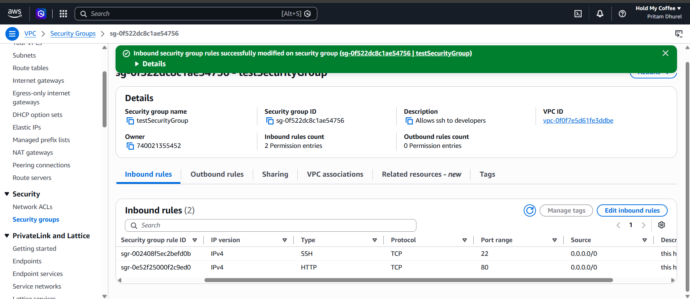

My first CI/CD project

Github Actions

The cloud deployment resources

1. VPC - (name: test-1)

2. Subnet
   - Public Ip (10.0.0.0/24 CIDR range)

3. Internet Gateway (name: test-internet-gateway)

4. Route table
   routes
   - 0.0.0.0 --> Internet Gateway
   - 10.0.0.0 --> local

5. Security Groups
   - SSH
   - HTTP
     
