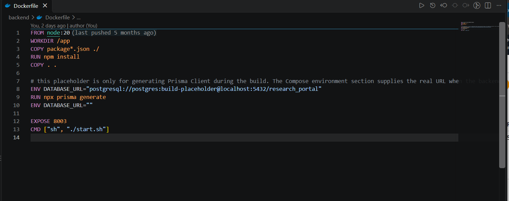
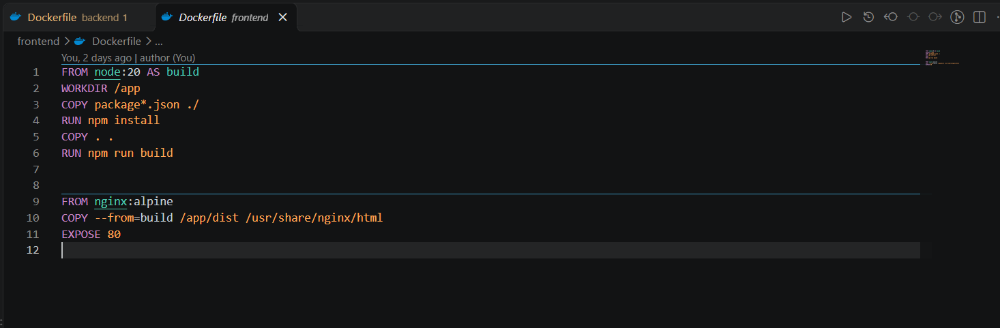
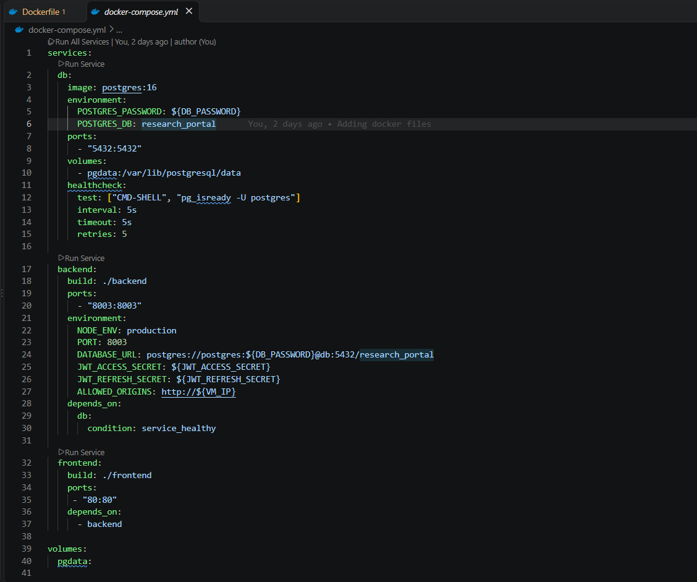
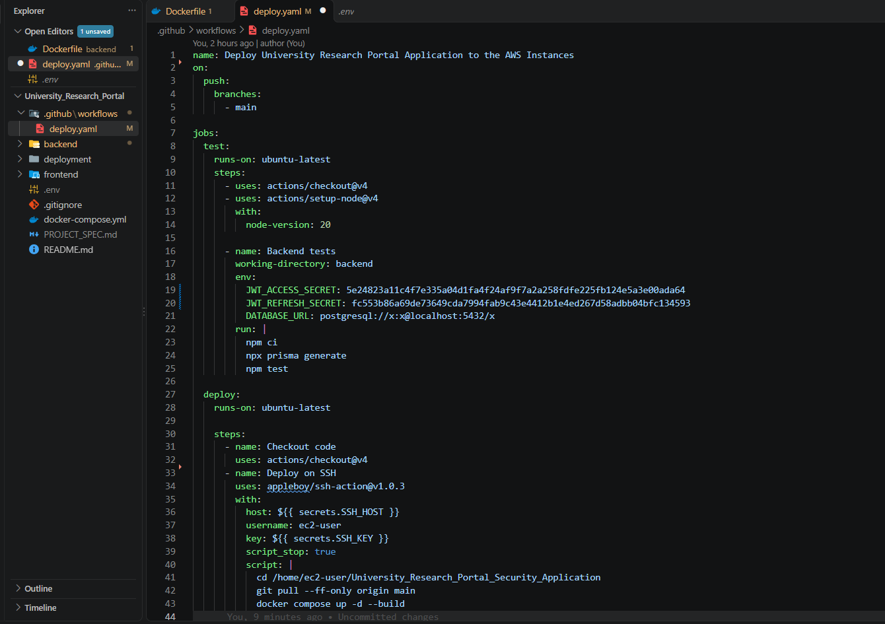
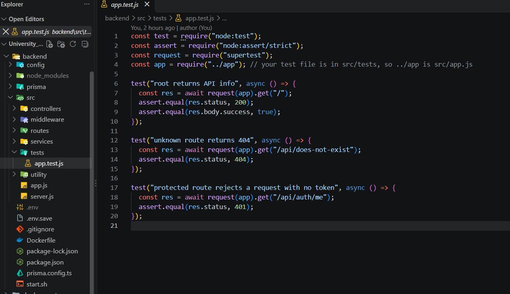
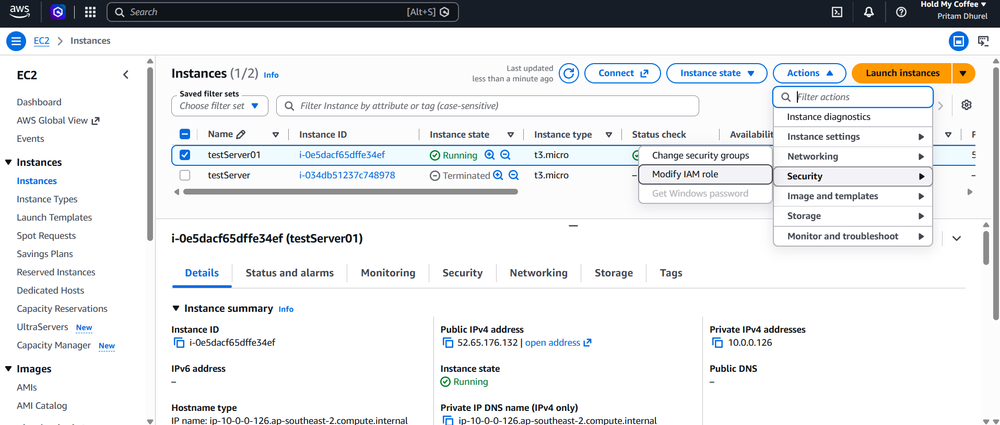

My first CI/CD project

Github Actions

The cloud deployment resources

AWS Cloud Deployment Architecture for the University Research Portal Security Application.

## Code

github

- **[University Research Portal — Docker Deployment](https://github.com/pritamdhurel-tech/University_Research_Portal_Security_Application)**

## Dockerfiles

# backend

# frontend

# Docker compose file

# github actions

- docker.yaml
  

# test files

# Cloud - AWS

1. VPC - (name: test-1)
   

2. Subnet
   - Public Ip (10.0.0.0/24 CIDR range)
     

3. Internet Gateway (name: test-internet-gateway)
   

4. Route table
   routes
   - 0.0.0.0 --> Internet Gateway
   - 10.0.0.0 --> local
     

5. Security Groups
   - SSH
   - HTTP
     

6. Resource Map
   

7. Instance
   
